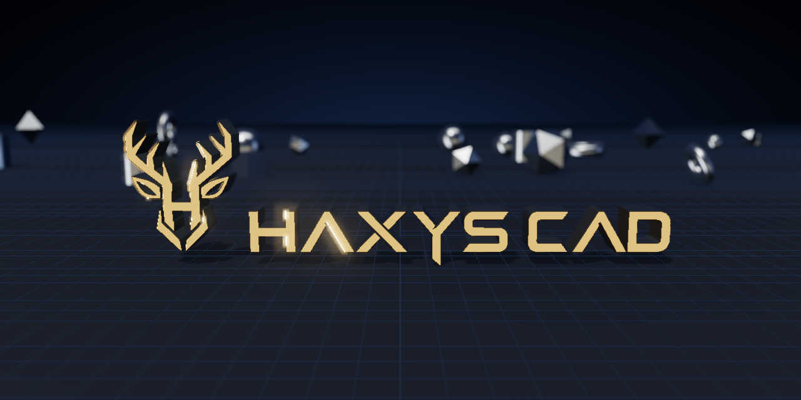

<p align="right"><a href="README.md">🇧🇷 Português</a></p>

<p align="center">
  
</p>

<h3 align="center">Free 3D CAD with an AI that builds the part from your voice.</h3>

<p align="center">
  Autodesk Fusion-style workspace · prints on Bambu Lab · also on your phone
</p>

<p align="center">
  <a href="https://github.com/HAXYS-CAD/haxys-cad/releases/latest"></a>
  <a href="docs/en/celular.md"></a>
  <a href="LICENSE"></a>
  
</p>

> The HAXYS CAD interface is in Brazilian Portuguese today. Other languages are coming soon.

---

## What's inside

<table>
<tr>
<td width="33%" valign="top">

### 🖥 HAXYS CAD
**The desktop app.** Model 3D parts with sketch, extrude, revolve, hole, fillet, mesh, surface and assembly tools, laid out like Fusion. Opens STEP, STL, OBJ, 3MF and DXF, exports STEP / STL / 3MF and sends straight to the printer.


</td>
<td width="33%" valign="top">

### 📱 HAXYS CAD mobile
**The same app on your phone.** Tap 🎤, say the part you want (or send photos) and the AI builds it. Opens from a QR code, on the same Wi-Fi as the PC.<br>
<sub>🔜 Coming soon: use it anywhere, without the PC turned on.</sub>


</td>
<td width="33%" valign="top">

### 🤖 AI that builds
**Talk and the part appears.** The HAXYS CAD AI uses your own account (free Gemini, ChatGPT/Codex, Claude, or an AI running on your PC). It can also replicate a part from photos. Through the **MCP bridge**, Claude, Codex and Gemini CLI open HAXYS CAD and build on their own.


</td>
</tr>
</table>

## Why HAXYS CAD

- **If you know Fusion, you already know it.** Same tabs, panels, tool names, timeline and browser.
- **Real AI, for free.** Say "make a 60 by 60 plate with four 5 mm holes" and it builds, checks and measures. Send photos and it replicates the part.
- **From screen to printer.** One click sends the part (3MF, one object per body) to Bambu Studio. Works with other printers through STL/3MF, and with laser cutting (SVG).
- **No account, no subscription.** Everything runs on your computer. Your projects live in `Documents\HAXYS CAD`.
- **Open source.** MIT license: use, study, change and share.

## Install in 3 steps

<p align="center"></p>

1. Open the **[Releases](https://github.com/HAXYS-CAD/haxys-cad/releases/latest)** page and download `HAXYS-CAD-Setup-<version>.exe`.
2. Double-click the file. If **"Windows protected your PC"** shows up, click **More info** → **Run anyway** (the installer is free, so it has no paid signature).
3. Follow the installer. HAXYS CAD opens by itself and adds a desktop shortcut.

**Or paste this into PowerShell** (Start → type *PowerShell* → Enter). It downloads the latest version and opens the installer:

```powershell
irm https://github.com/HAXYS-CAD/haxys-cad/releases/latest/download/instalar.ps1 | iex
```

**Or ask your AI to install it.** Paste into Claude Code, Codex or Gemini CLI:

```text
Install HAXYS CAD on this computer: run in PowerShell
irm https://github.com/HAXYS-CAD/haxys-cad/releases/latest/download/instalar.ps1 | iex
and tell me when the installer opens. Then connect the HAXYS CAD bridge to yourself
following https://github.com/HAXYS-CAD/haxys-cad/blob/main/docs/en/ia.md
```

Full step-by-step guide with pictures: **[docs/en/instalar.md](docs/en/instalar.md)**.

## More

| | |
|---|---|
| 🚀 [Getting started](docs/en/primeiros-passos.md) | Your first part in 5 minutes |
| 🛠 [Tools](docs/en/ferramentas.md) | Everything HAXYS CAD does, tab by tab |
| 🤖 [AI and MCP bridge](docs/en/ia.md) | Free AI, Claude, Codex and Gemini CLI (with ready-made prompts) |
| 📱 [Phone](docs/en/celular.md) | HAXYS CAD mobile over Wi-Fi |
| 🖨 [Printing](docs/en/impressao.md) | Bambu Lab, other printers and laser |
| ❓ [FAQ](docs/en/perguntas.md) | Windows warning, where files are saved, troubleshooting |
| 👩‍💻 [For developers](docs/en/para-quem-programa.md) | Run from source, project layout and contributing |

---

<sub>Inspired by the Autodesk Fusion workflow. HAXYS CAD is not affiliated with Autodesk or Bambu Lab; names belong to their owners.<br>
© 2026 HAXYS · [MIT License](LICENSE) · [Contributing](CONTRIBUTING.md) · [Security](SECURITY.md) · [Changelog](CHANGELOG.md)</sub>
