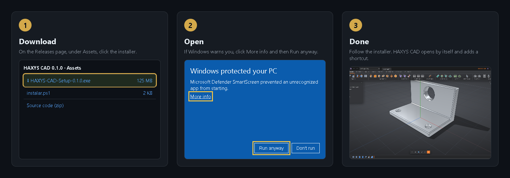

# Install HAXYS CAD

[← Back](../../README.en.md) · [🇧🇷 Português](../pt/instalar.md)

You need: **Windows 10 or 11** (64-bit), about **600 MB** free, and internet only to download.



## Option 1: download and click (easiest)

1. Click **[⬇ Download HAXYS CAD](https://github.com/HAXYS-CAD/haxys-cad/releases/latest/download/HAXYS-CAD-Setup.exe)**.
2. The file `HAXYS-CAD-Setup.exe` (about 125 MB) goes to your **Downloads** folder.
3. Double-click the file.
4. Windows may show **"Windows protected your PC"**. That's normal: the installer is free and has no paid digital signature. Click **More info** and then **Run anyway**.
5. Pick a folder (or keep the suggested one) and click **Next** until the end.
6. Done: HAXYS CAD opens by itself. There's a shortcut on the desktop and in the Start menu.

## Option 2: one PowerShell command

1. Click **Start**, type `PowerShell` and press **Enter**.
2. Copy the line below (📋 button at the corner of the box), paste it into the blue window with a right-click and press **Enter**:

```powershell
irm https://github.com/HAXYS-CAD/haxys-cad/releases/latest/download/instalar.ps1 | iex
```

3. The command downloads the latest version from the HAXYS GitHub itself and opens the installer. Continue from step 4 of Option 1.

## Option 3: ask your AI

If you use **Claude Code**, **Codex** or **Gemini CLI**, paste:

```text
Install HAXYS CAD on this computer: run in PowerShell
irm https://github.com/HAXYS-CAD/haxys-cad/releases/latest/download/instalar.ps1 | iex
and tell me when the installer opens. Then connect the HAXYS CAD bridge to yourself
following https://github.com/HAXYS-CAD/haxys-cad/blob/main/docs/en/ia.md
```

## Update

Download the new version with Option 1 or 2 and install over the old one. Your projects stay in `Documents\HAXYS CAD`.

## Uninstall

Windows **Settings** → **Apps** → **HAXYS CAD** → **Uninstall**. Your projects in `Documents\HAXYS CAD` are not deleted.

Next: [Getting started](primeiros-passos.md).
