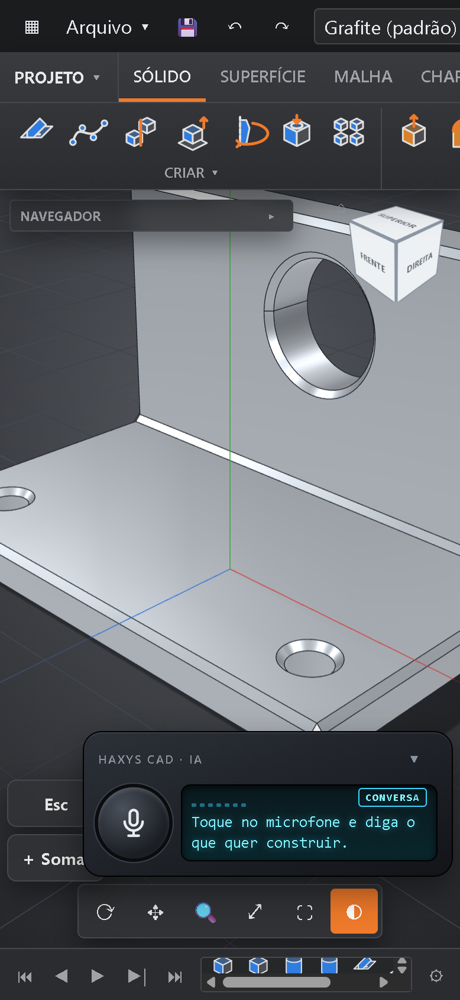

# HAXYS CAD no celular

[← Voltar](../../README.md) · [🇺🇸 English](../en/celular.md)

O celular abre o **mesmo HAXYS CAD do seu PC**, com tela de toque. A IA é a tela principal: toque no 🎤, diga a peça e veja ela aparecer.

## O que precisa

- O PC ligado com o **HAXYS CAD aberto**.
- O celular na **mesma Wi-Fi** do PC.
- Android (Chrome) ou iPhone (Safari).

## Ligar (uma vez)

1. No PC, clique no botão **📱** da barra de cima. Aparece um QR code.
2. No celular, abra a **câmera**, aponte para o QR code e toque no link.
3. Na primeira vez o celular avisa que a conexão **"não é particular"**. É normal: o certificado é do seu PC, não da internet. Toque em **Avançado → Continuar** (iPhone: **Mostrar detalhes → visitar este site**). É isso que libera o microfone.
4. Se o Windows perguntar, deixe o HAXYS CAD usar **Redes privadas**.
5. Para ter o ícone: menu do navegador → **Adicionar à tela inicial** (iPhone: **Compartilhar → Adicionar à Tela de Início**).

## Usar

- **🎤** fala com a IA. **▾** minimiza a caixa para ver a peça; **▴** volta.
- **Fotos:** anexe fotos da peça que quer copiar.
- **Esc** e **＋ Somar** na barra de toque; segurar o dedo = botão direito.
- Exportar baixa o arquivo no celular e também grava na pasta do PC.

## Em breve: sem o PC

Estamos construindo o HAXYS CAD móvel que funciona **em qualquer lugar, sem o PC ligado**: você tira a foto na rua, a IA monta, você salva, e a peça **aparece sozinha** no HAXYS CAD do seu PC quando chegar em casa.
