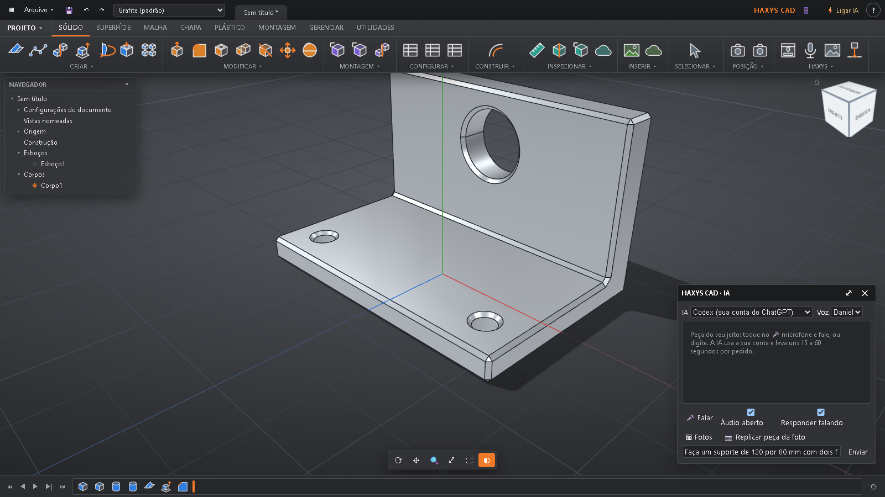

# IA e ponte MCP

[← Voltar](../../README.md) · [🇺🇸 English](../en/ia.md)

Existem dois jeitos de usar IA com o HAXYS CAD. Você pode usar um, outro ou os dois.



## Jeito 1: a IA dentro do HAXYS CAD (🎤)

1. Clique em **⚡ Ligar IA** (barra de cima).
2. Escolha uma opção:
   - **Gemini (Google): grátis.** Crie uma chave grátis no [Google AI Studio](https://aistudio.google.com/apikey) com sua conta Google, copie e cole no HAXYS CAD.
   - **Ollama ou LM Studio:** IA rodando no seu próprio PC, grátis e sem internet (precisa de um PC com boa placa de vídeo).
   - **Codex** (conta do ChatGPT) ou **Claude Code**, se já estiverem instalados neste PC.
   - **OpenAI, Claude, OpenRouter, Groq** ou outra compatível: com a sua chave (a empresa pode cobrar pelo uso).
3. Clique no 🎤 **Falar com a IA** e peça a peça. Pode falar ou digitar.
4. **Replicar peça da foto:** mande fotos (com uma régua ou objeto de tamanho conhecido ajuda) e a IA monta a peça, dizendo de onde tirou cada medida.

A chave fica só no seu PC (`Documentos\HAXYS CAD\ia.json`). O HAXYS CAD não cobra nada.

## Jeito 2: a ponte MCP (a sua IA abre o HAXYS CAD e constrói)

**MCP** é o padrão que as IAs usam para mexer em programas. A ponte do HAXYS CAD dá à IA quatro ferramentas: `abrir_haxys`, `construir` (ações de CAD), `estado_do_projeto` e `ver_tela` (foto da peça). A IA **não** roda código no seu computador.

A ponte vem com o programa instalado, neste arquivo:

```text
%LOCALAPPDATA%\Programs\HAXYS CAD\resources\ponte\haxys-ponte.mjs
```

**Antes:** de preferência, deixe o **HAXYS CAD aberto**. Para Codex, Claude Code e Gemini CLI, instale também o [Node.js](https://nodejs.org) (versão LTS).

### Claude Desktop

Baixe `HAXYS_CAD.mcpb` na página [Releases](https://github.com/HAXYS-CAD/haxys-cad/releases/latest) e dê dois cliques nele (ou Claude → Configurações → Extensões → arraste o arquivo). Clique em **Instalar**. Não precisa de Node.js.

### Claude Code

```powershell
claude mcp add haxys -- node "$env:LOCALAPPDATA\Programs\HAXYS CAD\resources\ponte\haxys-ponte.mjs" --stdio
```

### Codex (ChatGPT no computador)

No arquivo `%USERPROFILE%\.codex\config.toml`, acrescente (troque `SEU_USUARIO` pelo seu usuário do Windows):

```toml
[mcp_servers.haxys]
command = "node"
args = ['C:\Users\SEU_USUARIO\AppData\Local\Programs\HAXYS CAD\resources\ponte\haxys-ponte.mjs', '--stdio']
startup_timeout_sec = 60
tool_timeout_sec = 240
```

### Gemini CLI

No arquivo `%USERPROFILE%\.gemini\settings.json`, dentro de `"mcpServers"`:

```json
"haxys": {
  "command": "node",
  "args": ["C:\\Users\\SEU_USUARIO\\AppData\\Local\\Programs\\HAXYS CAD\\resources\\ponte\\haxys-ponte.mjs", "--stdio"]
}
```

Depois de configurar, feche e abra o app da IA.

### Prompt pronto para a IA configurar sozinha

Cole no Claude Code, no Codex ou no Gemini CLI:

```text
Ligue a ponte MCP do HAXYS CAD em você. Ela fica em
%LOCALAPPDATA%\Programs\HAXYS CAD\resources\ponte\haxys-ponte.mjs e roda com
"node <esse caminho> --stdio". Confira se o Node.js está instalado, cadastre o
servidor MCP com o nome "haxys" no seu arquivo de configuração e me diga para
reiniciar você. Siga https://github.com/HAXYS-CAD/haxys-cad/blob/main/docs/pt/ia.md
```

### Prompts para testar

```text
Abra o HAXYS e faça uma placa de 60 por 60 por 6 mm com 4 furos de 5 mm nos cantos.
```

```text
Faça um suporte em L de 120 x 80 mm, parede de 70 mm, dois furos de 9 mm na base
e um furo de 28 mm na parede. Depois tire uma foto da tela e confira.
```

## Limitações conhecidas

- Se o HAXYS CAD estiver fechado, a ponte abre o programa sozinha e espera ele ficar pronto (uns 30 segundos). Deixar aberto é mais rápido.
- A IA do Jeito 1 com Gemini grátis tem limite de pedidos por dia (definido pelo Google).
- IAs pelo site (ChatGPT, claude.ai) precisam de um túnel para chegar ao seu PC: é avançado e não é recomendado para começar.
