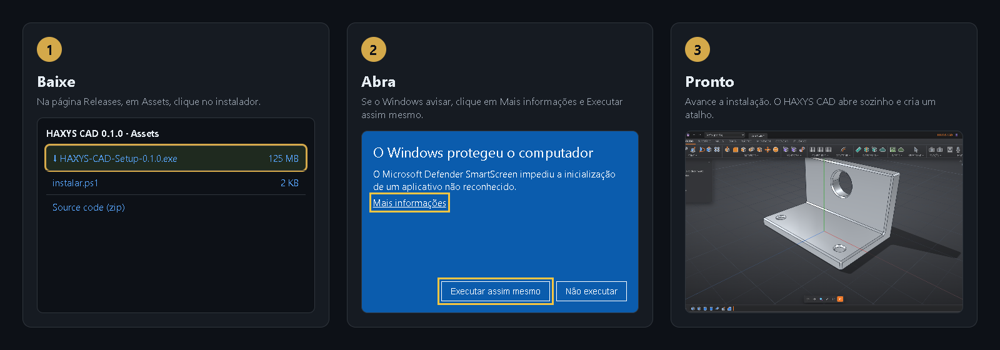

# Instalar o HAXYS CAD

[← Voltar](../../README.md) · [🇺🇸 English](../en/instalar.md)

Precisa de: **Windows 10 ou 11** (64 bits), uns **600 MB** livres e internet só para baixar.



## Jeito 1: baixar e clicar (o mais fácil)

1. Clique em **[⬇ Baixar o HAXYS CAD](https://github.com/HAXYS-CAD/haxys-cad/releases/latest/download/HAXYS-CAD-Setup.exe)**.
2. O arquivo `HAXYS-CAD-Setup.exe` (uns 125 MB) vai para a pasta **Downloads**.
3. Dê dois cliques no arquivo.
4. O Windows pode mostrar **"O Windows protegeu o computador"**. É normal: o instalador é grátis e não tem uma assinatura digital paga. Clique em **Mais informações** e depois em **Executar assim mesmo**.
5. Escolha a pasta (ou deixe a que aparece) e clique em **Avançar** até o fim.
6. Pronto: o HAXYS CAD abre sozinho. Há um atalho na Área de Trabalho e no menu Iniciar.

## Jeito 2: um comando no PowerShell

1. Clique no botão **Iniciar**, digite `PowerShell` e aperte **Enter**.
2. Copie a linha abaixo (botão 📋 no canto do quadro), cole na janela azul com o botão direito do mouse e aperte **Enter**:

```powershell
irm https://github.com/HAXYS-CAD/haxys-cad/releases/latest/download/instalar.ps1 | iex
```

3. O comando baixa a versão mais nova do próprio GitHub da HAXYS e abre o instalador. Siga do passo 4 do Jeito 1.

## Jeito 3: pedir para a sua IA

Se você usa o **Claude Code**, o **Codex** ou o **Gemini CLI**, cole:

```text
Instale o HAXYS CAD neste computador: rode no PowerShell
irm https://github.com/HAXYS-CAD/haxys-cad/releases/latest/download/instalar.ps1 | iex
e me avise quando o instalador abrir. Depois, ligue a ponte do HAXYS CAD em você
seguindo https://github.com/HAXYS-CAD/haxys-cad/blob/main/docs/pt/ia.md
```

## Atualizar

Baixe a versão nova pelo Jeito 1 ou 2 e instale por cima. Seus projetos continuam em `Documentos\HAXYS CAD`.

## Desinstalar

**Configurações** do Windows → **Aplicativos** → **HAXYS CAD** → **Desinstalar**. Seus projetos em `Documentos\HAXYS CAD` não são apagados.

Próximo: [Primeiros passos](primeiros-passos.md).
