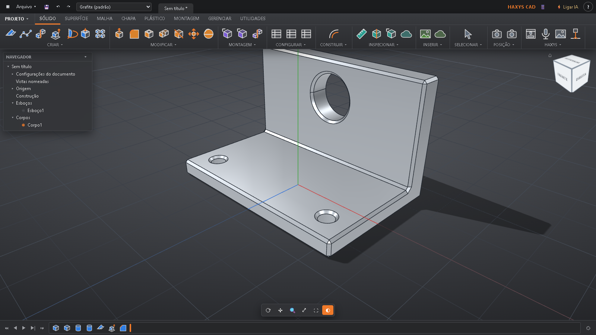

# Primeiros passos

[← Voltar](../../README.md) · [🇺🇸 English](../en/primeiros-passos.md)

Na primeira vez, o HAXYS CAD mostra um tutorial curto de 5 passos. Este guia faz a mesma coisa com uma peça de verdade.

## A tela

- **Faixa de cima:** as abas (SÓLIDO, SUPERFÍCIE, MALHA, MONTAGEM, UTILIDADES...) com as ferramentas, como no Fusion.
- **Navegador (esquerda):** esboços, corpos e planos do projeto. O ◉ mostra ou esconde.
- **Cubo de vistas (direita, em cima):** clique numa face para ver de frente, de cima...
- **Linha do tempo (embaixo):** cada operação feita. Clique duas vezes para mudar uma medida.

## Mexer na vista

- **Girar:** arraste com o botão esquerdo.
- **Mover:** arraste com o botão direito.
- **Zoom:** rodinha do mouse.

## Sua primeira peça (placa com furos)

1. Aba **SÓLIDO** → **Criar esboço** → clique no plano do chão.
2. Escolha **Retângulo**, clique em dois cantos e digite as medidas (ex.: 60 e 60).
3. Clique em **Concluir esboço**.
4. **Extrusão** → clique no retângulo → digite `6` → **OK**. Agora é uma placa de 60 × 60 × 6 mm.
5. **Furo** → clique na face de cima onde quer o furo → diâmetro `5` → **OK**.
6. **Arredondar** → clique nas arestas → raio `2` → **OK**.

## Ou peça para a IA

Clique no 🎤 **Falar com a IA** (aba SÓLIDO, painel HAXYS) e diga:
*"Faça uma placa de 60 por 60 por 6 com quatro furos de 5 mm nos cantos."* Veja [IA e ponte MCP](ia.md).

## Salvar, exportar e imprimir

- **Arquivo → Salvar** (Ctrl+S): grava em `Documentos\HAXYS CAD\projetos`.
- **Arquivo → Exportar:** STEP (outros CAD), STL ou 3MF (impressão).
- **Imprimir:** veja [Impressão](impressao.md).

## Ajuda dentro do programa

Botão **?** no canto de cima: pare o mouse em cima de qualquer coisa para ver o que faz. **Esc** sai. Botão direito no **?** abre o tutorial de novo.
